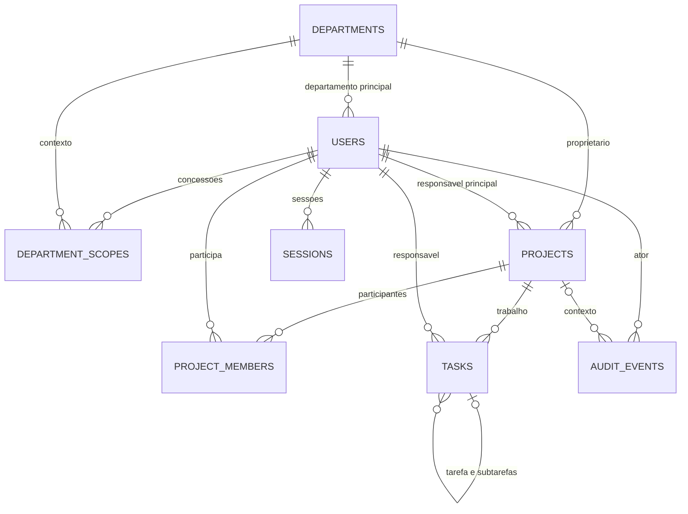

# Modelo de dados e invariantes — ERP Projetos Web Terra

**Estado**: desenho lógico/físico proposto para aprovação, sem DDL, models ou migrações executáveis. Baseline de negócio: propostas autorizadas para uso no plano; D-01–D-07 de [plan.md](plan.md) ainda precisam de definição.

## Convenções

PostgreSQL 17 proposto; UUID para identificadores, `DATE` para prazos e `TIMESTAMPTZ` para instantes com referência UTC. `created_at`/`updated_at` são gerados no servidor. Entidades mutáveis têm `version` inteiro positivo, iniciado em 1 e incrementado por mudança confirmada. Status/prioridade/perfil são códigos restritos por CHECK nomeado e validação de domínio, não texto livre. Valores de API em [contracts/api.md](contracts/api.md).

Não armazenar progresso, atraso ou totais como campos manuais. Não existirão tabelas de orçamento, custos, riscos, capacidade, marcos, aprovação ou notificações. O modelo não contém multiempresa nem habilita múltiplos perfis silenciosamente.

## Relacionamentos

O diagrama é conceitual; profundidade tarefa→subtarefa é uma restrição, não uma hierarquia ilimitada. `local_credentials` é condicional a D-01 e fica fora do diagrama-base.

## Entidades e campos

| Tabela / módulo | Campos principais | Constraints e validações |
| --- | --- | --- |
| `departments` / organization | `id`, `name`, `is_active`, `version`, instantes | Nome não vazio; normalização para evitar duplicata conforme critério corporativo; desativação depende do tratamento de vínculos/projetos abertos, sem apagar referências |
| `users` / organization + identity | `id`, `display_name`, `login_identifier`, `department_id`, `profile_code`, `is_active`, `version`, instantes | Identificador normalizado único; departamento principal FK; perfil único entre administrator/executive/project_manager/department_lead/contributor; exceções de múltiplos perfis dependem de D-03 |
| `department_scopes` / identity | `user_id`, `department_id`, `version`, instantes | PK composta; FKs; contexto expressamente concedido para leitura/ação que o perfil permite. Escopo não concede ação fora do perfil. Alteração bloqueia a linha do usuário e gera audit |
| `projects` / projects | `id`, `name`, `description` opcional, `department_id`, `owner_user_id`, `priority`, `status`, `due_date`, `completed_at` opcional, `version`, instantes | FKs para departamento/usuário; data-limite obrigatória na baseline; status planned/in_progress/completed; prioridade low/medium/high; completed_at só com status completed. Nome obrigatório, sem unicidade global inventada |
| `project_members` / projects | `project_id`, `user_id`, `is_active`, `version`, instantes | PK composta; FKs; uma participação por pessoa/projeto. Remoção é revogação lógica, preservando associações históricas. Responsável principal deve ter participação ativa; garantido pelo caso de uso transacional e teste de invariantes |
| `tasks` / work | `id`, `project_id`, `parent_task_id` opcional, `title`, `status`, `priority`, `due_date`, `assignee_user_id`, `version`, instantes | FK de projeto; FK composta `(project_id, assignee_user_id)` para participação; `UNIQUE(id, project_id)` e FK composta `(parent_task_id, project_id)` para tarefa do mesmo projeto; parent != self; status todo/in_progress/done; prioridade low/medium/high |
| `sessions` / identity | `id`, `user_id`, `token_digest`, `csrf_token`, `created_at`, `expires_at`, `last_seen_at`, `revoked_at` opcional | Token de sessão opaco de alta entropia; somente seu hash/digest é armazenado, único, nunca exposto. CSRF é um token sincronizado aleatório mantido na sessão, entregue apenas pelo endpoint autenticado específico e nunca em logs; não autentica sozinho. TTL/idle timeout dependem de D-01. Sessão não armazena permissões definitivas |
| `audit_events` / audit | `id`, `actor_user_id`, `actor_label_snapshot`, `occurred_at`, `entity_type`, `entity_id`, `project_id` opcional, `department_id` opcional, `action`, `before_values`, `after_values`, `correlation_id` | JSONB com campos permitidos; contexto capturado no evento; ator/entidade rastreáveis mesmo após desativação. Sem cascade; append-only para runtime; evento não é uma tabela pública de segredos |

`local_credentials`, **somente se D-01 escolher identidade local**: `user_id` PK/FK, `password_hash` Argon2id, `password_changed_at` e estado de provisionamento. Nunca senha em texto, hash no retorno da API ou senha em seed versionado. Recuperação/provisionamento depende de política aprovada; o plano não cria automaticamente rotas de redefinição insegura. Se OIDC for escolhido, modelar associação única issuer/subject↔user e remover a proposta local do escopo; não implantar ambos sem requisito.

Sessões e credenciais pertencem à persistência de identidade, não às representações públicas de usuário. Identificador de login e mapeamento corporativo devem ser validados em D-01; email é candidato de identidade local, não garantia de diretório empresarial existente.

### Restrições que exigem domínio, não apenas FK/CHECK

- Usuários/departamentos/participações precisam estar ativos para novas concessões ou atribuições.
- Responsável principal precisa ser elegível, participante ativo e autorizado na matriz; manter owner e participação na mesma transação. Evita-se FK circular de project para membership em favor de operação explícita e testes.
- FK de parent garante mesmo projeto; profundidade máxima de um nível e regra de conclusão dependem de consultar outras linhas. Um CHECK comum não pode validar grandparent ou “todas subtarefas concluídas”.
- Participação revogada permanece como linha histórica, mas não é elegível. FK não concede permissão nem prova que is_active é true.
- Desativação/revogação não pode deixar trabalho aberto sem responsável elegível. Bloquear até reassociação conforme RB-11; a mudança de perfil/contexto também verifica esse efeito.
- Inserir subtarefa em tarefa já concluída depende de D-06: proposta é reabrir a tarefa antes, evitando conclusão incoerente. Projeto concluído bloqueia mudanças até reabertura explícita.
- Relação entre prazo da tarefa e do projeto é D-02; não adicionar constraint de comparação até a regra ser definida.

## Estados e cálculos

| Entidade | Transições baseline | Condições |
| --- | --- | --- |
| Projeto | planned → in_progress; planned/in_progress → completed; completed → in_progress por reabertura | Matriz autoriza a ação; concluir exige ao menos uma folha, todas folhas done e todas tarefas-pai done; complete/reopen são comandos explícitos auditados |
| Tarefa independente/subtarefa | todo ↔ in_progress ↔ done; permite todo ↔ done conforme baseline Q2 | Responsável/gestor autorizado, projeto editável; não alterar outras propriedades pelo comando de status |
| Tarefa-pai | Mesmos códigos de tarefa | Só passa a done se todas subtarefas estão done; reabrir subtarefa de pai done força pai para in_progress atomicamente |
| Usuário/departamento/participação | active → inactive; reativação por ação permitida | Preserva histórico; respeita responsabilidades/vínculos e não reativa concessões antigas por acidente |

`completed_at` representa conclusão vigente; reabertura limpa esse valor vigente e preserva a conclusão anterior no histórico. Não se usa esse campo para módulo de desempenho histórico não previsto.

**Progresso**: folhas = tarefas sem filhos + subtarefas. Numerador = folhas done; denominador = total de folhas. Retornar ambos e percentual derivado com uma casa decimal; denominador zero produz `percentage: null`, não 0/100% arbitrários. Uma tarefa concluída independente + três subtarefas (duas done) resultam em 3/4 = 75,0%. Tarefa-pai não conta novamente. Percentual arredondado não habilita conclusão.

**Atraso**: item aberto com `due_date < corporate_today`, onde corporate_today deriva de instante do servidor no fuso corporativo explícito. Projeto usa próprio prazo; trabalho atrasado não altera sozinho a classificação do projeto. Folhas por status são unidade de contagem do dashboard; Kanban exibe tarefas-pai sem duplicação e subtarefas no seu contexto.

**Dashboard**: filtrar escopo antes de agregação. Consulta composta usa snapshot único consistente, devolve `as_of`, `timezone`, filtros normalizados e unidade de contagem. Filtro de responsável/prazo/status de trabalho não redefine progresso integral do projeto. Sem médias globais ou métricas futuras.

## Protocolo transacional e de locks

1. Abrir sessão/transação de caso de uso e validar formato. Consultas preliminares para identificar IDs não autorizam operação; repetir decisões dentro do protocolo.
2. Ordenar locks para todas as linhas envolvidas: usuários por UUID (shared quando só validar, exclusive ao alterar identidade/perfil/concessões), departamentos por UUID, projetos por UUID e tarefas por UUID. O projeto sempre precede locks de suas tarefas. Aplicar a mesma ordem em reassociação, revogação e desativação.
3. Reavaliar usuário ativo, perfil, escopos e participação vigentes sob locks. Mudanças de concessão bloqueiam exclusivamente a linha do usuário alvo; comandos de atribuição também validam/bloqueiam o responsável alvo. Mudanças departamentais seguem lock equivalente. Isso evita atribuição simultânea a pessoa desativada.
4. Todo comando que cria/altera tarefa, participação ou condições de conclusão bloqueia o projeto exclusivamente antes de validar estado/trabalho. Alteração de metadados, complete e reopen usam o mesmo protocolo.
5. Comparar `expected_version` ou `expected_project_version` conforme contrato. Rejeitar versão divergente sem aplicar efeitos. Conferir elegibilidade, profundidade, campos e transição; atualizar linhas afetadas e versões, inclusive version do projeto quando o trabalho/participação mudou.
6. Inserir evento de campos permitidos na mesma transação. Falha em evento, constraint ou concorrência causa rollback completo.
7. Confirmar e só então responder. Não guardar resposta de sucesso antes do commit. Timeout/deadlock não implica aplicação parcial; retornar falha documentada e permitir releitura, sem retry infinito ou replay automático cego do cliente.

Escrita exclusiva por projeto é deliberada para segurança no MVP. Mudanças de um projeto não serializam todo o portfólio. Operações de desativação que afetam vários projetos devem enumerá-los e adquirir locks na ordem estável; os locks dos usuários envolvidos impedem novas atribuições durante a verificação. SQL direto que contorne protocolo não é um caminho permitido da aplicação.

Sessão expirada/inativa/revogada é rejeitada em cada nova operação. Uma operação já autorizada em andamento pode concluir antes de a revogação obter seu lock; uma operação iniciada após o commit da revogação deve negar. Definir e testar esse limite para não prometer cancelar retroativamente transações já confirmadas.

Versionamento SQLAlchemy via `version_id_col` pode complementar a comparação do contrato; operações bulk que não passam por flush/versionamento/políticas são proibidas nos comandos de negócio. Consultas de dashboard não modificam dados e podem usar `REPEATABLE READ` para seus agregados; nunca manter transação aberta enquanto o usuário interage.

## Índices propostos

- Identificador normalizado de usuário único; departamento/perfil/ativo para seletores autorizados.
- `department_scopes(user_id, department_id)` e índice inverso para manutenção de departamento.
- `projects(department_id, status, due_date, id)` e `projects(owner_user_id, id)`; avaliar seletividade em fixtures volumosas.
- `project_members(user_id, is_active, project_id)` para escopo por participação, além da PK.
- `tasks(project_id, parent_task_id, id)`, `tasks(project_id, status, due_date, id)` e `tasks(assignee_user_id, status, due_date, id)`.
- `sessions(token_digest)` único; user/revoked/expiry para revogação e limpeza operacional.
- `audit_events(project_id, occurred_at, id)` e `audit_events(entity_type, entity_id, occurred_at, id)` para paginação determinística.

Não criar cada índice por hábito: revisar planos de consulta e custo de escrita com dados sintéticos. IDs não substituem autorização; UUID não é medida suficiente de isolamento.

## Migrações e dados sintéticos

Criar constraints nomeadas e revisões Alembic na implementação, com upgrade vazio/versão anterior testados. Não há migração nesta entrega. Usar papel separado para migração e runtime; o runtime só lê/insere eventos, sem alterar schema.

Fixtures futuras: dois departamentos fictícios, contas dos cinco perfis com contextos distintos, projeto com 3/4 folhas concluídas, projeto vazio, projeto concluído, prazos passado/hoje/futuro e pessoas inativas. Provisionar contas de teste por mecanismo seguro e efêmero, não por senha estática no Git. IDs determinísticos de fixtures podem existir, credenciais não.

Expurgo de sessões expiradas é housekeeping operacional; frequência depende de política, sem fila obrigatória. Retenção/expurgo de histórico ou dados empresariais depende de D-04 e não é habilitado por uma simples migração de instalação.
