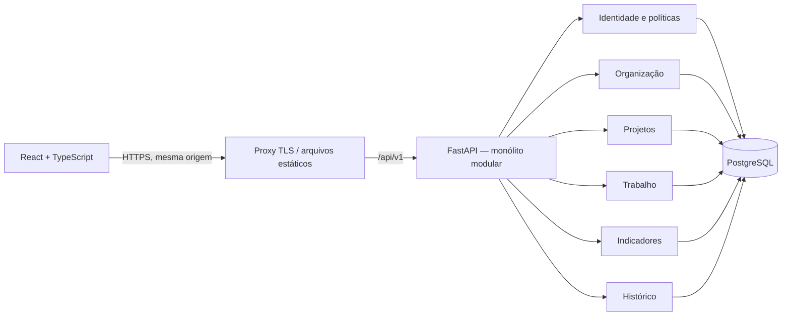

# Implementation Plan: ERP Projetos Web Terra — MVP

**Branch**: `feat/erp-projetos-terra-spec` | **Date**: 2026-10-13 | **Spec**: [spec.md](spec.md)

**Input**: Especificação de `specs/001-erp-projetos-terra/spec.md` e pedido de planejamento técnico com React/TypeScript, FastAPI, PostgreSQL, SQLAlchemy/Alembic e Pytest/Playwright.

**Status**: Plano técnico para aprovação. Não autoriza implementação ou implantação. O usuário confirmou nesta etapa: “Usar as propostas no plano e destacar as definições restantes”. As propostas RB-01–RB-12 e a matriz de Q1 são a baseline de desenho; definições não fornecidas permanecem no registro D-01–D-07 abaixo. O arquivo de especificação e seu checklist histórico foram preservados, sem fingir que Q1–Q3 foram integralmente respondidas.

## Summary

Aplicação web com frontend separado e um backend transacional organizado por módulos. Uma implantação backend, um PostgreSQL e chamadas internas explícitas; sem microsserviços, filas, event sourcing ou caches de autorização no MVP. A API é a única autoridade para permissões, progresso, atraso, conclusão e rastreabilidade. Os diagramas e contratos descrevem o sistema futuro; nenhum componente foi instalado ou executado nesta etapa.



## Technical Context

**Language/Version**: TypeScript com React 19 e Python 3.12. Node 24 LTS para ferramentas. Famílias propostas: TypeScript 5, SQLAlchemy 2, Alembic 1, Psycopg 3, Pydantic 2, PostgreSQL 17. Versões exatas compatíveis e patches serão fixados em lockfiles na implementação; não se promete compatibilidade testada agora. Python 3.12.14 e Node 24.19.0 estão presentes na máquina, mas a stack da aplicação não foi instalada.

**Primary Dependencies**: FastAPI/Uvicorn, SQLAlchemy, Alembic e Psycopg; React/TypeScript, Vite e React Router. TanStack Query é recomendado para dados remotos e invalidação pós-mudança, sem armazenar credenciais nem decisões de acesso. Validação de fronteira com Pydantic. Argon2id se identidade local for escolhida; OIDC somente se a política corporativa exigir, sem implementar os dois caminhos antecipadamente.

**Storage**: Um PostgreSQL transacional, com tabelas de organização, projetos, tarefas, autorização, sessões e auditoria. Progresso e atraso derivados. Sem Redis, armazenamento de arquivos ou banco analítico obrigatório.

**Testing**: Pytest para domínio, políticas, integração PostgreSQL e contratos; Playwright para jornadas de navegador. Todos os dados de desenvolvimento/teste são sintéticos. PostgreSQL real e descartável nos testes que dependem de constraints, datas e locks.

**Target Platform**: Navegadores corporativos atuais em desktop e telas móveis; backend Linux; frontend estático servido sob a mesma origem da API. Não há modo offline ou aplicativo nativo.

**Project Type**: Aplicação web corporativa interna, monólito modular com SPA separada.

**Performance Goals**: Baseline proposta SC-007: p95 de consultas utilizáveis em até 3 segundos; volume, concorrência e condições de medição ainda D-05. Não há benchmark nesta etapa.

**Constraints**: Contexto obrigatório em autorização backend; histórico e mutação atômicos; sem segredos no Git ou dados reais em dev. Sem decisão implícita de política corporativa. Sessões revogáveis, queries autorizadas e concorrência sobre o agregado projeto.

**Scale/Scope**: Uma empresa, cinco perfis e somente o MVP da especificação. Sem escala fictícia presumida. Paginação e índices desde o início; medir antes de aumentar infraestrutura.

## Constitution Check

*GATE: avaliar antes da pesquisa e após o desenho.*

A constituição existente é um template não ratificado. Seus placeholders não foram tratados como princípios aprovados e ela não foi alterada por esta skill. A solicitação autoriza o planejamento documental; ratificar princípios é uma revisão separada antes de implementation.

| Gate da solicitação/repositório | Antes do desenho | Após o desenho |
| --- | --- | --- |
| Somente artefatos de planejamento | PASS | PASS: não há código, banco, manifests ou serviços novos |
| Modularidade e simplicidade | PASS | PASS: seis módulos internos, um backend e um banco |
| Separação frontend/backend/persistência | PASS | PASS: módulos HTTP/aplicação/domínio/persistência com fronteiras explícitas |
| Acesso no backend e dados autorizados | PASS | PASS no desenho; depende de testes futuros, não de uma alegação de validação da aplicação |
| Segredos fora do repositório; dados fictícios | PASS | PASS no desenho; contrato não contém credenciais nem dados empresariais |
| Preservar documentos e não decidir regras de negócio silenciosamente | PASS | PASS: baseline autorizada para planejamento e pendências explícitas |
| Q1–Q3, metas operacionais e constituição ratificadas | PENDENTE | PENDENTE: D-01–D-07 impedem declarar liberação para implementação/produção |

Não há violação que justifique adicionar infraestrutura. Há pendências de governança/negócio: desenho concluído para revisão, não gate final aprovado. Não executar `$speckit-tasks` ou `$speckit-implement` nesta entrega.

## Project Structure

### Documentation (this feature)

```text
specs/001-erp-projetos-terra/
├── spec.md
├── plan.md
├── research.md
├── data-model.md
├── contracts/
│   └── api.md
├── quickstart.md
└── checklists/requirements.md   # registro da revisão da especificação
```

`tasks.md` não é criado na fase de planejamento. O contrato é normativo em Markdown com tipos e exemplos; OpenAPI será exposto pelo FastAPI e verificado contra este contrato durante a implementação, sem inventar uma API já executável.

### Source Code (repository root)

Estrutura **proposta**, não diretórios criados nesta etapa:

```text
frontend/
├── package.json                 # futuro manifesto e lockfile
├── src/
│   ├── app/                     # composição, rotas e sessão
│   ├── features/
│   │   ├── identity/
│   │   ├── organization/
│   │   ├── projects/
│   │   ├── work/
│   │   ├── dashboard/
│   │   └── history/
│   └── shared/                  # cliente HTTP, tipos e componentes de interface
└── tests/                       # navegador/componentes quando necessários
backend/
├── pyproject.toml               # futuro manifesto e lockfile
├── src/erp/
│   ├── main.py                  # composição da aplicação
│   ├── core/                    # configuração, conexão, sessão, erros e correlação
│   └── modules/
│       ├── identity/
│       ├── organization/
│       ├── projects/
│       ├── work/
│       ├── reporting/
│       └── audit/
│           # cada módulo: api/, application/, domain/, persistence/
├── migrations/                  # Alembic; única sequência de revisões
└── tests/{unit,integration,contract}/
tests/e2e/                       # Playwright com dados e contas sintéticas
ops/                             # futuros Dockerfiles, compose local e runbooks
.github/workflows/               # futuros checks CI e implantação autorizada
```

**Structure Decision**: Fronteiras por capacidade, evitando repositório genérico e abstrações repetidas. Handlers HTTP usam casos de uso; políticas/domínio não dependem de FastAPI; persistência SQLAlchemy permanece interna ao módulo. Um coordenador de transação liga mudanças de módulos que precisam confirmar juntas. Módulos não importam routers ou detalhes de persistência alheios; usam interfaces pequenas de aplicação/query. Não duplicar tabelas de usuário/projeto por módulo.

## Limites dos módulos e rastreabilidade

| Módulo | Responsabilidade e fronteira | Requisitos |
| --- | --- | --- |
| identity | Entrada/saída, sessões, perfil, concessões e avaliação central de ação/contexto; não decide status de trabalho | FR-001–004, FR-007, NFR-001 |
| organization | Usuários, departamentos, vínculos e elegibilidade; mudança de concessão usa identity e registra audit | FR-005–008, FR-014 |
| projects | Metadados, participantes, responsável, estados e conclusão/reabertura; dono do agregado que serializa mudanças | FR-009–011, FR-018–019 |
| work | Tarefas/subtarefas, hierarquia, responsáveis e status; respeita bloqueio/regra do projeto e participa de sua transação | FR-012–017 |
| reporting | Consultas autorizadas, filtros, folhas, atrasos e dashboard; somente leitura; sem orçamento/capacidade | FR-020–023, FR-021–022 |
| audit | Inserção de eventos transacionais e leitura autorizada; sem alterações públicas nos eventos | FR-024–025, NFR-005 |
| Frontend/transversais | Menu, tabelas, cards, Kanban acessível, estados de erro/conflito e adaptação de tela; decisões finais ficam na API | FR-026–027, NFR-002–004, NFR-006–007 |

## Segurança, autenticação e autorização

Sessão opaca em PostgreSQL, transportada por cookie `HttpOnly`, `Secure`, `SameSite=Lax`, sem token persistido no armazenamento JavaScript. Produção usa `__Host-erp_session`, `Path=/` e nenhum atributo `Domain`. Só o hash do segredo aleatório de sessão é persistido. Política de expiração e recuperação é D-01, não um número inventado.

Origem única e HTTPS reduzem CORS; mutações autenticadas também exigem token CSRF vinculado à sessão em `X-CSRF-Token`, além de verificação estrita de `Origin`. Login deve exigir origem permitida, prevenir fixação e renovar sessão; mensagens de credenciais inválidas são genéricas e tentativas limitadas. SameSite isoladamente não protege todo fluxo. Hash Argon2id apenas se login local for aprovado; conta fictícia de dev não determina identidade de produção.

Toda operação reavalia usuário ativo e concessões vigentes; sessão não guarda papel/contexto como autorização definitiva. Filtro de escopo é aplicado **antes** de paginação, totais e agregação; recursos inacessíveis retornam 404 uniforme, operações globais sem permissão retornam 403, sessão ausente/inválida retorna 401. Administrador de cadastros não recebe leitura total de projetos implicitamente. Diretórios de responsáveis retornam apenas opções elegíveis para o contexto, sem abrir lista global de pessoas.

## Persistência, validação e concorrência

SQLAlchemy 2 síncrono e Psycopg 3, com sessão por requisição/caso de uso e transação explícita. Handlers síncronos do FastAPI para operações de banco; não bloquear event loop em endpoints `async` com sessões síncronas. Não compartilhar Session entre threads ou requisições.

Todo comando valida identidade/contexto, valores, elegibilidade, hierarquia, estado e versão antes de confirmar; banco acrescenta FKs, unicidade e checks estruturais. Mudança e histórico confirmam juntos ou sofrem rollback juntos. Nenhum sucesso HTTP antes do commit. Credencial runtime não modifica/exclui audit_events; migração/backup têm identidades separadas.

Cada entidade editável possui `version`. Contratos exigem versão esperada em mutações; conflito retorna 409 e pede releitura. Todo comando de trabalho/participação/conclusão também adquire lock da linha do projeto: criar tarefa e concluir projeto competem pelo mesmo lock. Lock somente na conclusão seria insuficiente. Reabertura de subtarefa e tarefa-pai ocorre na mesma transação. O progresso é derivado de contagens exatas; arredondamento é somente apresentação. Detalhes em [data-model.md](data-model.md).

## Configuração, ambientes e segredos

Separar development, CI/test, staging e production: bancos, credenciais, domínios, logs e backups próprios. Configuração tipada deve falhar na inicialização ao faltar requisito obrigatório. `CORPORATE_TIMEZONE` não recebe default silencioso. Segredos vêm de injeção segura/gestor da plataforma, nunca de configuração versionada ou campos `VITE_*`, que são públicos no bundle.

Documentar posteriormente um `.env.example` só com nomes/placeholders não secretos: URL de banco, origem pública, fuso, cookie seguro, expiração de sessão, CSRF, identidade escolhida, limites de tentativa e política de observabilidade. Valores reais ficam em bindings secretos e arquivos locais ignorados. Não incluir credenciais, senhas de seed ou `storageState` do Playwright no Git. O ambiente antigo de Selenium/LinkedIn não é dependência do ERP.

Dados sintéticos identificados como fictícios; nenhuma cópia/restauração de produção em dev/CI/staging comum. Fixtures independentes por teste/worker, sem pessoas, nomes ou projetos reais da empresa.

## Migrações, testes e backups

Alembic: revisão única por alteração lógica, constraints/índices nomeados, autogenerate revisado manualmente. CI testa banco vazio até head e upgrade da versão anterior com fixtures. Job de migração exclusivo por release com papel próprio, sem migração automática por cada worker. Para alterações incompatíveis, expand/contract e compatibilidade entre versões; renomeações e transformações não são aprovadas automaticamente pelo diff. Rollback de aplicação ou correção adiante preferidos; downgrade destrutivo não é garantia de recuperação.

Pytest valida regras/políticas, API, PostgreSQL e transações; testes negativos e concorrentes têm prioridade. Playwright valida jornadas autorizadas, Kanban, conflito/erro e teclado. Contratos fixam tipos, paginação, erros e proibição de campos indevidos; OpenAPI gerado deve estar alinhado. Não substituir PostgreSQL por SQLite nos testes de locks/FKs/datas. Matriz detalhada em [quickstart.md](quickstart.md).

Backups futuros criptografados e com acesso segregado, preferindo PostgreSQL gerenciado com backup automatizado e PITR. Dump lógico complementa portabilidade, não substitui política de continuidade. RPO, RTO e retenção são D-04. Validar restauração em ambiente isolado, migrações, contagens, histórico e autorização antes do go-live; nunca restaurar dados reais no ambiente de desenvolvimento. Nenhum backup é executado nesta fase.

## Estratégia de implantação futura

Frontend buildado e imutável; backend em container Linux com health/readiness; proxy TLS encaminha `/api/v1` e serve estáticos sob mesma origem. PostgreSQL em rede privada, preferencialmente gerenciado. Sem Kubernetes obrigatório. Backend pode ganhar workers após medir pool de conexões e limites do banco; sessão no banco permite isso sem sticky sessions.

CI futura: instalação por lockfiles → lint/tipos → testes unitários/contrato/integração → testes de migração → builds → scan de segredos/dependências → staging → E2E/restore rehearsal → aprovação de produção. Versão de frontend/API/contrato é liberada de modo compatível. Migração executada uma vez, readiness validada e release observada; rollback de imagem só quando schema permanece compatível. Logs estruturados com correlação e sem credenciais, métricas de falhas/latência/locks/pool; ferramentas escolhidas na implantação, sem acrescentar plataforma operacional agora.

## Decisões técnicas e definições restantes

| ID | Definição e consequência | Estado |
| --- | --- | --- |
| D-01 | Identidade local versus SSO corporativo, provisionamento/recuperação, expiração e limitação de tentativas; sessão opaca do ERP permanece recomendada para ambos | Requer decisão de negócio/segurança; contrato login local é condicional |
| D-02 | Fuso IANA corporativo e comportamento de prazo de tarefa além do projeto | Requer definição; nenhum default para calendário nem aceitação/rejeição de prazo |
| D-03 | Alcance de histórico do colaborador, acúmulo de perfis e exceções de concessão/contexto ainda não explicitadas | Baseline Q1 para desenho; fechar políticas de casos pendentes antes de implementar |
| D-04 | Retenção do histórico/backups, autorização operacional excepcional, disponibilidade, RPO e RTO | Requer política corporativa; sem metas inventadas |
| D-05 | Volume, concorrência e condições do piloto para validar p95/usabilidade | Requer dimensionamento; 3s/95% continuam proposta |
| D-06 | Tratamento de cadastro indevido sem exclusão definitiva/cancelamento e inclusão de subtarefa em tarefa já concluída | Política proposta: reabrir antes de incluir subtarefa; confirmar na revisão, sem módulo novo |
| D-07 | Ratificação da constituição e aprovação deste plano/contratos/decisões técnicas | Governança pendente; nenhuma skill de implementação foi executada |

Pesquisas técnicas foram resolvidas em [research.md](research.md); decisões corporativas acima não podem ser substituídas por pesquisa técnica. O gate de liberação segue pendente. Não há declaração de readiness de aplicação ou ambiente da stack.

## Complexity Tracking

Sem violações de complexidade que precisem de exceção. Os trade-offs estão em [research.md](research.md): uma transação por comando, serialização por projeto e consultas diretas favorecem integridade e manutenção ao custo de throughput por projeto; aumento de complexidade depende de medição.
